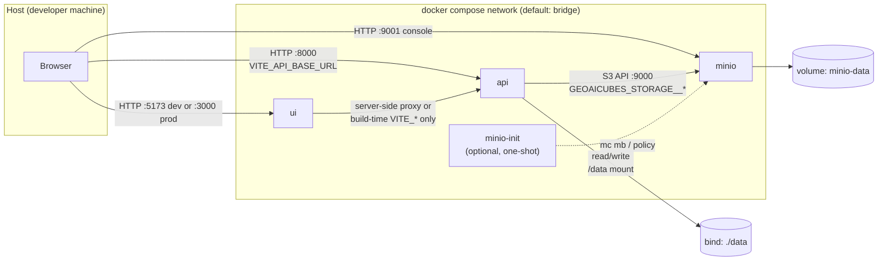

# Docker Compose topology (design)

**Task:** Step 0 **D6** — design reference for **I6** (`deploy/docker-compose.yml`, Dockerfiles, `config/.env.example`).  
**Not in scope here:** runnable Compose file, production hardening, or GPU images.

Authoritative env names and port defaults live in [docs/scaffold.md](../docs/scaffold.md). Demo path defaults live in [config/demo.yaml](../config/demo.yaml).

## Goals

- Run **API**, **viewer UI**, and **MinIO** together for local S3-style tests and demo stack smoke (Step 0 **R5**).
- **CPU-only** images (no CUDA/NVIDIA runtime).
- Mount host **`data/`** (and derived outputs under it) into the API; keep one Python core in the API container.
- Viewer build context: **`apps/viewer/`** (browser talks to API on the host-mapped port only).
- Align storage credentials: `MINIO_ROOT_*` on the MinIO service ↔ `GEOAICUBES_STORAGE__ACCESS_KEY_ID` / `GEOAICUBES_STORAGE__SECRET_ACCESS_KEY` on the API.

## Service diagram



| Service | Role | Required |
|---------|------|----------|
| `api` | FastAPI (`geoaicubes.api.main:app`), loads `config/demo.yaml`, serves `/health`, `/ready`, `/api/v1/...` | Yes |
| `ui` | Svelte/Vite viewer from `apps/viewer/` | Yes |
| `minio` | S3-compatible object storage for published/demo objects | Yes |
| `minio-init` | One-shot bucket create (and optional anonymous read policy for dev) | Optional (recommended for I6) |

## Port matrix

Host ports are fixed for this scaffold so they match `config/demo.yaml` and [docs/scaffold.md](../docs/scaffold.md).

| Service | Container port | Host port | Consumer |
|---------|----------------|-----------|----------|
| `api` | `8000` | `8000` | Browser (`VITE_API_BASE_URL`), `curl`, Compose healthcheck |
| `ui` (Vite dev) | `5173` | `5173` | Browser (local dev image / `Dockerfile.dev`) |
| `ui` (production) | `80` | `3000` | Browser (nginx in `deploy/Dockerfile.ui`; see [docs/scaffold.md](../docs/scaffold.md)) |
| `minio` S3 API | `9000` | `9000` | API (`GEOAICUBES_STORAGE__ENDPOINT_URL` from **host**); maps to `http://minio:9000` **inside** Compose |
| `minio` console | `9001` | `9001` | Browser (MinIO web UI) |

**URL split (important for I6):**

| Client | API base URL | MinIO S3 endpoint |
|--------|--------------|-------------------|
| Browser on host | `http://localhost:8000` | N/A (viewer does not call MinIO directly) |
| `api` container | — | `http://minio:9000` via `GEOAICUBES_STORAGE__ENDPOINT_URL` override in Compose |
| `uv run` on host (no Compose) | `http://localhost:8000` | `http://localhost:9000` (defaults in `demo.yaml`) |

## Volumes and paths

All paths below are relative to the **repository root** (directory containing `pyproject.toml`).

| Mount | Service | Container path | Mode | Purpose |
|-------|---------|----------------|------|---------|
| `./data` | `api` | `/app/data` | `rw` (or `ro` until exports write back) | Zarr cubes, labels, **`derived/`** outputs (`classification_output`, `change_map_output` in `demo.yaml`) |
| `./config` | `api` | `/app/config` | `ro` | `demo.yaml` SSOT |
| `minio-data` (named volume) | `minio` | `/data` | `rw` | MinIO object store (buckets live here; separate from Zarr on disk unless synced intentionally) |

Set `GEOAICUBES_PATHS__DATA_ROOT=/app/data` in the `api` service so relative paths in `demo.yaml` resolve inside the container:

| Config key | Example relative path | Resolves under mount |
|------------|------------------------|----------------------|
| `paths.cube_zarr` | `geodatacubes/montseny-demo.zarr` | `/app/data/geodatacubes/...` |
| `paths.label_raster` | `cobertes-sol/labels/...` | `/app/data/cobertes-sol/...` |
| `paths.classification_output` | `derived/classification_montseny.tif` | `/app/data/derived/...` |
| `paths.change_map_output` | `derived/change_map_montseny.tif` | `/app/data/derived/...` |

Empty `data/` is valid for Step 0 smoke: `/health` and `/ready` should succeed; asset routes may return placeholders until fetch/ML steps run.

**Do not** bind-mount secrets. Use `env_file: config/.env` (gitignored) or shell env; ship **`config/.env.example`** in I6.

## CPU-only images (I6 guidance)

| Service | Base image (suggested) | Notes |
|---------|------------------------|--------|
| `api` | `python:3.12-slim-bookworm` | Install project with **uv** or `pip` from `pyproject.toml`; **no** `nvidia-*` base, **no** GPU extras |
| `ui` | `node:22-alpine` (build) + `nginx:alpine` or `node:22-alpine` (dev) | Multi-stage: build static assets from `apps/viewer/`, serve with nginx on port 80 → publish **3000** on host |
| `minio` | `minio/minio:RELEASE.2024-*` (pin a recent tag in I6) | Official image; CPU-only |
| `minio-init` | `minio/mc:RELEASE.2024-*` | Ephemeral; `restart: "no"` |

Pin image digests or minor tags in I6; avoid `latest` for reproducibility.

## Environment variables by service

Use the same names as [docs/scaffold.md](../docs/scaffold.md). Values below are Compose-oriented defaults; secrets come from `.env`.

### `api`

| Variable | Example (Compose) | Notes |
|----------|-------------------|--------|
| `GEOAICUBES_PATHS__DATA_ROOT` | `/app/data` | Required in container |
| `GEOAICUBES_STORAGE__ENDPOINT_URL` | `http://minio:9000` | **Internal** DNS name |
| `GEOAICUBES_STORAGE__BUCKET` | `geoaicubes-demo` | Match `demo.yaml` / `MINIO_BUCKET` |
| `GEOAICUBES_STORAGE__PREFIX` | `montseny/` | From demo config |
| `GEOAICUBES_STORAGE__REGION` | `us-east-1` | MinIO signing |
| `GEOAICUBES_STORAGE__USE_SSL` | `false` | Plain HTTP inside bridge network |
| `GEOAICUBES_STORAGE__ACCESS_KEY_ID` | same as `MINIO_ROOT_USER` | Secret |
| `GEOAICUBES_STORAGE__SECRET_ACCESS_KEY` | same as `MINIO_ROOT_PASSWORD` | Secret |
| `GEOAICUBES_API_PORT` | `8000` | Uvicorn bind (optional; default 8000) |
| `GEOAICUBES_CORS_ORIGINS` | `http://localhost:5173,http://localhost:3000` | Dev UI origins |

Optional bbox/date/path overrides: any `GEOAICUBES_*` from scaffold.md.

### `ui`

| Variable | Example | Notes |
|----------|---------|--------|
| `VITE_API_BASE_URL` | `http://localhost:8000` | **Build-time** for Vite; must be reachable from the **browser**, not from inside the `ui` container |
| `VITE_*` (future) | — | Map/layer IDs when viewer scaffold grows |

For production UI image, bake `VITE_API_BASE_URL` at `docker build` via `ARG`/`ENV` in `apps/viewer` Dockerfile.

### `minio`

| Variable | Example | Notes |
|----------|---------|--------|
| `MINIO_ROOT_USER` | `geoaicubes` | Dev-only; align with API storage keys |
| `MINIO_ROOT_PASSWORD` | (secret in `.env`) | Dev-only |
| `MINIO_BROWSER_REDIRECT_URL` | `http://localhost:9001` | Optional console redirect |

Command: `server /data --console-address ":9001"`.

### `minio-init` (optional)

| Variable | Example | Notes |
|----------|---------|--------|
| `MINIO_ROOT_USER` | same as `minio` | For `mc alias` |
| `MINIO_ROOT_PASSWORD` | same as `minio` | |
| `MINIO_BUCKET` | `geoaicubes-demo` | Create if missing |
| `MINIO_ENDPOINT` | `http://minio:9000` | Internal |

Script pattern: wait for MinIO live → `mc mb --ignore-existing local/$MINIO_BUCKET` → exit 0. No long-running process.

## Health checks

Probes should pass with **empty `data/`** (liveness only; readiness may report config loaded).

| Service | Type | Command / endpoint | Interval (suggested) |
|---------|------|--------------------|----------------------|
| `api` | HTTP GET | `http://127.0.0.1:8000/health` → JSON `status: ok` | 10s, start_period 15s |
| `api` | (manual / future) | `GET /ready` → `demo_config_loaded: true` | Not required for container `HEALTHCHECK` in Step 0 |
| `ui` (dev) | HTTP GET | `http://127.0.0.1:5173/` | 10s, start_period 30s |
| `ui` (prod) | HTTP GET | `http://127.0.0.1:80/` or `:3000` | Match chosen internal port |
| `minio` | HTTP GET | `http://127.0.0.1:9000/minio/health/live` | 10s, start_period 10s |

Example `healthcheck` fragments for I6:

```yaml
# api — needs curl or wget in image
healthcheck:
  test: ["CMD", "curl", "-fsS", "http://127.0.0.1:8000/health"]
  interval: 10s
  timeout: 5s
  retries: 3
  start_period: 15s

# minio
healthcheck:
  test: ["CMD", "curl", "-fsS", "http://127.0.0.1:9000/minio/health/live"]
  interval: 10s
  timeout: 5s
  retries: 5
  start_period: 10s
```

`minio-init` has no healthcheck; use `depends_on` with `condition: service_healthy` on `minio`.

## Build contexts and Dockerfile layout (I6)

| Artifact | Context | Dockerfile (proposed path) |
|----------|---------|------------------------------|
| API | repo root (`.`) | `deploy/Dockerfile.api` |
| UI | `apps/viewer/` | `apps/viewer/Dockerfile` or `deploy/Dockerfile.ui` with `context: ../apps/viewer` |

API image should copy `src/geoaicubes/`, `pyproject.toml`, `uv.lock`, and install the package; entrypoint: `uvicorn geoaicubes.api.main:app --host 0.0.0.0 --port 8000` (or `uv run` equivalent).

UI **must** use `apps/viewer/` as build context per project layout ([README.md](../README.md)).

## Networking and startup order

1. Start `minio` → wait until healthy.
2. Run `minio-init` (if present) → exit 0.
3. Start `api` (depends on MinIO healthy; **not** on init for `/health`, but S3 calls need bucket).
4. Start `ui` (depends on `api` healthy optional; viewer can load with API down but health smoke should wait for API).

Expose only required host ports. Do not publish MinIO credentials in the image.

## Commented compose stub (I6 starting point)

Copy and flesh out in `deploy/docker-compose.yml`; names and ports must match this doc.

```yaml
# deploy/docker-compose.yml — IMPLEMENT in I6; not wired in D6
name: geoaicubes

services:
  minio:
    image: minio/minio:RELEASE.2024-12-18T13-15-44Z # pin in I6
    command: server /data --console-address ":9001"
    ports:
      - "9000:9000"
      - "9001:9001"
    environment:
      MINIO_ROOT_USER: ${MINIO_ROOT_USER}
      MINIO_ROOT_PASSWORD: ${MINIO_ROOT_PASSWORD}
    volumes:
      - minio-data:/data
  # healthcheck: see COMPOSE.md

  minio-init:
    image: minio/mc:RELEASE.2024-12-18T16-21-29Z
    depends_on:
      minio:
        condition: service_healthy
    environment:
      MINIO_ROOT_USER: ${MINIO_ROOT_USER}
      MINIO_ROOT_PASSWORD: ${MINIO_ROOT_PASSWORD}
      MINIO_BUCKET: ${MINIO_BUCKET:-geoaicubes-demo}
    entrypoint: >
      /bin/sh -c "
      mc alias set local http://minio:9000 $$MINIO_ROOT_USER $$MINIO_ROOT_PASSWORD &&
      mc mb --ignore-existing local/$$MINIO_BUCKET
      "
    restart: "no"

  api:
    build:
      context: ..
      dockerfile: deploy/Dockerfile.api
    ports:
      - "8000:8000"
    env_file:
      - ../config/.env
    environment:
      GEOAICUBES_PATHS__DATA_ROOT: /app/data
      GEOAICUBES_STORAGE__ENDPOINT_URL: http://minio:9000
    volumes:
      - ../data:/app/data
      - ../config:/app/config:ro
    depends_on:
      minio:
        condition: service_healthy

  ui:
    build:
      context: ../apps/viewer
      dockerfile: Dockerfile
      args:
        VITE_API_BASE_URL: http://localhost:8000
  # Dev: publish 5173:5173 ; prod: 3000:80 — pick in I6

volumes:
  minio-data:
```

## Makefile targets (I7 preview)

Document in I7; expected invocations:

- `docker compose -f deploy/docker-compose.yml --env-file config/.env up -d --build`
- `docker compose -f deploy/docker-compose.yml down`

Run from repo root; Compose file paths above assume `deploy/docker-compose.yml` with build `context: ..`.

## Acceptance checklist (D6 done → I6 ready)

- [x] Services `api`, `ui`, `minio`, optional `minio-init` defined with roles and dependencies.
- [x] Host ports **8000**, **5173** / **3000**, **9000**, **9001** documented.
- [x] `data/` and `derived/` layout via single API bind mount; MinIO named volume.
- [x] CPU-only image strategy; no GPU.
- [x] Healthcheck commands for API, UI, MinIO.
- [x] Env vars aligned with [docs/scaffold.md](../docs/scaffold.md).
- [x] I6: implement files, `config/.env.example`, and E1 run matrix in `docs/scaffold.md`.

## Related deliverables

| ID | Artifact |
|----|----------|
| D3 | [docs/scaffold.md](../docs/scaffold.md) — env and provisional ports |
| I6 | `deploy/docker-compose.yml`, `deploy/Dockerfile.api`, UI Dockerfile, `config/.env.example` |
| E1 | Full run matrix and confirmed UI production port |
| R5 | `docker compose ... up` smoke with empty `data/` |