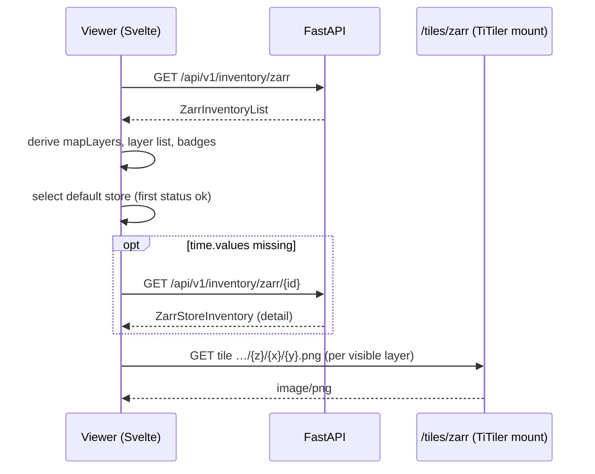

# Viewer information architecture (Step 1 — D4)

| Field | Value |
|-------|--------|
| Status | **Accepted** (Wave 1 design) |
| Date | 2026-11-20 |
| Deliverable trace | Step 1 → D2.1 viewer shell; implements **I7** in Wave 4 |
| Schema contract | [`inventory-schema.md`](inventory-schema.md) |
| Tile contract | [`titiler-integration.md`](titiler-integration.md) |

## Purpose

Define layout, UI components, client state, and **data flow from the inventory API** for the Step 1 discovery viewer. Step 1 scope is **Zarr store inventory + map preview** — not AI layers, stats, or export (later steps).

## Non-negotiable boundaries

| Rule | Implication |
|------|-------------|
| **Viewer → API only** | All HTTP from the browser uses `VITE_API_BASE_URL` (see [`apps/viewer/.env.example`](../../apps/viewer/.env.example)). No MinIO console, no second tile host, no direct `s3://` from the browser. |
| **No Zarr/Xarray in the frontend** | `apps/viewer/package.json` must not depend on `zarr`, `xarray`, or Python tooling. Tiles are **pre-built URL templates** from inventory; the map client only substitutes `{z}`, `{x}`, `{y}` (and optional time query params per TiTiler contract). |
| **Validation is display-only** | The viewer surfaces `status` / `error` from the API; it does not re-introspect stores. |

## API surface (viewer contract)

| Call | When | Response type |
|------|------|----------------|
| `GET /health` | App shell / connection badge (existing Step 0) | Health JSON |
| `GET /api/v1/inventory/zarr` | Primary load on map view mount | [`ZarrInventoryList`](inventory-schema.md#zarrinventorylist) |
| `GET /api/v1/inventory/zarr/{id}` | Optional: refresh one store after time/detail needs | [`ZarrStoreInventory`](inventory-schema.md#zarrstoreinventory) |
| `GET {tile_url_template}` | Continuous while layers visible | PNG (TiTiler via API mount) |

Relative paths in `tile_url_template` values are resolved as `` `${apiBase}${template}` `` (no double slashes).

List enumeration semantics (per D2): HTTP **200** with per-store `status: "error"` entries — the UI **must** list broken stores and show errors inline, not fail the whole page.

## Screen layout

Single-page **map + sidebar** (desktop). Sidebar stacks **layer list** above **metadata / validation**; map fills remaining width.

```text
┌─────────────────────────────────────────────────────────────────┐
│ Header: title, API base (read-only), connection / inventory status │
├──────────────────┬──────────────────────────────────────────────┤
│ Layer list       │                                              │
│ (scroll)         │           Leaflet map                        │
│                  │     (base OSM + toggled tile overlays)       │
│ ───────────────  │                                              │
│ Metadata panel   │                                              │
│ (selected store) │                                              │
└──────────────────┴──────────────────────────────────────────────┘
```

On narrow viewports (&lt; 768px), sidebar becomes a bottom sheet or collapsible drawer; same component tree, no duplicate data fetching.

### Proposed component tree (`apps/viewer/` — I7)

| Component | Responsibility |
|-----------|----------------|
| `App.svelte` | Shell layout, `apiBase`, global fetch error banner |
| `lib/api/client.ts` | `fetchInventory()`, `fetchStore(id)`, typed errors |
| `lib/types/inventory.ts` | TypeScript shapes mirroring D2 (no code generation required in Step 1) |
| `lib/state/inventory.svelte.ts` | Normalized stores, derived `mapLayers`, selection, visibility |
| `LayerList.svelte` | Selectable rows, visibility checkbox, status badge |
| `MetadataPanel.svelte` | Dims, variables table, CRS, extent, chunks; inline validation |
| `TimeStepper.svelte` | Optional; bound to selected layer’s store `time` |
| `MapView.svelte` | Leaflet init, basemap, overlay registry, `fitExtent` |

Dependencies for I7: **`leaflet`** (+ CSS). Optional **`proj4`** for CRS → WGS84 when fitting bounds (see [Extent fit](#extent-fit)).

## Client domain model

### `MapLayer` (derived, not in API)

One **map layer** = one renderable variable (key in `tile_url_template`):

```text
layerId     = "{storeId}::{variableName}"
storeId     = ZarrStoreInventory.id
variable    = key in tile_url_template
tileUrl     = resolved template (apiBase + path + query)
status      = store.status (inherits error state)
visible     = UI boolean
timeIndex   = optional UI index when store.time present
```

Stores with `status: "error"` or empty `tile_url_template` produce **no tile overlays** but still appear in the layer list (store-level row or collapsed “unavailable” group).

### Selection model

- **Selected store** — drives metadata panel (one store at a time).
- **Visible layers** — independent toggles; multiple variables from the same store may be visible simultaneously (opacity stack order = list order, top = front).

## Data flow



### Bootstrap sequence

1. Read `VITE_API_BASE_URL`; normalize trailing slash.
2. `fetchInventory()` → on failure: banner + empty map (keep `/health` hint if useful).
3. Build `mapLayers` from each store’s `tile_url_template` keys.
4. Default selection: first store with `status === "ok"`, else first store.
5. If any visible layer has `extent`, offer **Fit all** using union of visible extents (see below).

### Tile layer lifecycle

For each `MapLayer` with `visible === true`:

1. `L.tileLayer(resolvedUrl, { opacity, attribution })` added to map.
2. On toggle off: `removeLayer` and drop reference.
3. On time index change: **remove and recreate** tile layer with updated query string (Leaflet does not hot-reload template).

Time query construction (viewer-side, aligns with [`titiler-integration.md`](titiler-integration.md)):

- When `time.values` is a non-empty array: append `&sel=time=${encodeURIComponent(values[timeIndex])}` to the template (repeatable `sel` form).
- When only `time.count` / `start` / `end` are present and `values` is `null`: show stepper  `0 … count-1` and either fetch detail once API enriches labels, or display index-only label until I4 exposes resolved timestamps in detail responses.

Do **not** send a bare `time_index` query param to TiTiler unless I5 documents it on the tile route; D3 reserves `time_index` for **inventory template generation**, not the browser.

## Layer list UX

| Element | Behavior |
|---------|----------|
| Row label | `{storeId}` or `{storeId} · {variable}` when multiple templates |
| Visibility checkbox | Enabled only when `status === "ok"` and template exists |
| Status badge | `ok` (neutral), `error` (destructive color) |
| Error hint | Truncated `error` on row; full text in metadata panel |
| Store grouping | Optional: one row per store, expand to variables when `Object.keys(tile_url_template).length > 1` |

Clicking a row sets **selected store** and focuses metadata; it does not auto-toggle visibility (explicit checkbox).

## Metadata / validation panel

Shows fields from the selected [`ZarrStoreInventory`](inventory-schema.md#zarrstoreinventory). **Errors inline** next to the field they affect:

| Field / section | Inline validation display |
|-----------------|---------------------------|
| `status` / `error` | Alert at top when `error`; blocks tile controls |
| `variables` | Table: name, dtype, shape; warn if variable missing from `tile_url_template` (“no tile preview”) |
| `extent` | Show bbox + crs; warn if `null` (“cannot fit map to this store”) |
| `crs` | Show; warn if `null` |
| `time` | Show dim, count, range; enable time stepper when applicable |
| `chunks`, `nodata` | Read-only detail (collapsed “Advanced”) |
| `uri` / `path` | Read-only (provenance); copy-friendly `<code>` |

List-level fetch failure (network / 5xx) uses a single page-level message, distinct from per-store `status: "error"`.

## Leaflet map

| Concern | Choice |
|---------|--------|
| Basemap | Default OSM or lightweight CDN tile layer (not inventory-backed) |
| Overlays | One `L.tileLayer` per visible `MapLayer` |
| CRS | **EPSG:3857** (standard Leaflet); TiTiler `WebMercatorQuad` matches |
| Controls | Layer visibility is driven from sidebar checkboxes (not mandatory Leaflet layers control in Step 1) |
| Attribution | API/demo attribution string on overlays; OSM on basemap |

No GeoJSON, WMS, or client-side raster math in Step 1.

## Extent fit

Trigger: toolbar button **Fit extent** (selected store) and **Fit visible** (union of visible layers).

Input: `InventoryExtent.bbox` + `InventoryExtent.crs` from inventory.

| `extent.crs` | Viewer action |
|--------------|----------------|
| `EPSG:4326` | `map.fitBounds([[miny, minx], [maxy, maxx]])` |
| Projected CRS (e.g. `EPSG:25831`, demo data) | Transform bbox corners to WGS84 with **proj4** (or equivalent), then `fitBounds` |
| `extent` is `null` | Disable fit for that scope; show inline warning in metadata |

Union for “Fit visible”: transform each layer’s store extent to WGS84, compute lat/lng min/max, single `fitBounds`.

Initial map view: after first successful inventory load, if demo config implies a known AOI, I7 may optionally fit **first ok store with extent** once (documented in implementation; not required for D4 acceptance).

## Optional time step

Render `TimeStepper.svelte` when selected store has `time != null` and (`time.count > 1` or `time.values?.length > 1`).

| Control | Binding |
|---------|---------|
| Slider or prev/next | `timeIndex` on selected store’s visible layer(s) |
| Label | ISO timestamp from `time.values[timeIndex]`, or `Step {i + 1} / {count}` fallback |

Changing time updates **all visible map layers** belonging to that store (same `time` dimension).

Hide stepper when `time` is absent or `count <= 1`.

## Configuration

| Env | Use |
|-----|-----|
| `VITE_API_BASE_URL` | API origin for inventory + tiles (build-time in Docker UI image) |

No viewer secrets; no storage credentials in the browser.

## Acceptance (D4 done)

- [x] Component layout documented (sidebar + map + header).
- [x] Data flow from `GET /api/v1/inventory/zarr` to layer list, metadata, and tile URLs documented.
- [x] Inline validation rules tied to D2 fields.
- [x] Leaflet overlay toggle and extent fit behavior specified.
- [x] Optional time step tied to `InventoryTime` and TiTiler `sel` contract.

Implementation checklist for **I7**: satisfy [`tasks/step1/plan.md`](../../tasks/step1/plan.md) Wave 4 brief; review gate **R5** (`rg` — no zarr/xarray in viewer).

## Related consumers

| Step | Artifact | Link |
|------|----------|------|
| D2 | Inventory schema | [`inventory-schema.md`](inventory-schema.md) |
| D3 | Tile mount + query params | [`titiler-integration.md`](titiler-integration.md) |
| I7 | Svelte implementation | [`apps/viewer/`](../../apps/viewer/) |